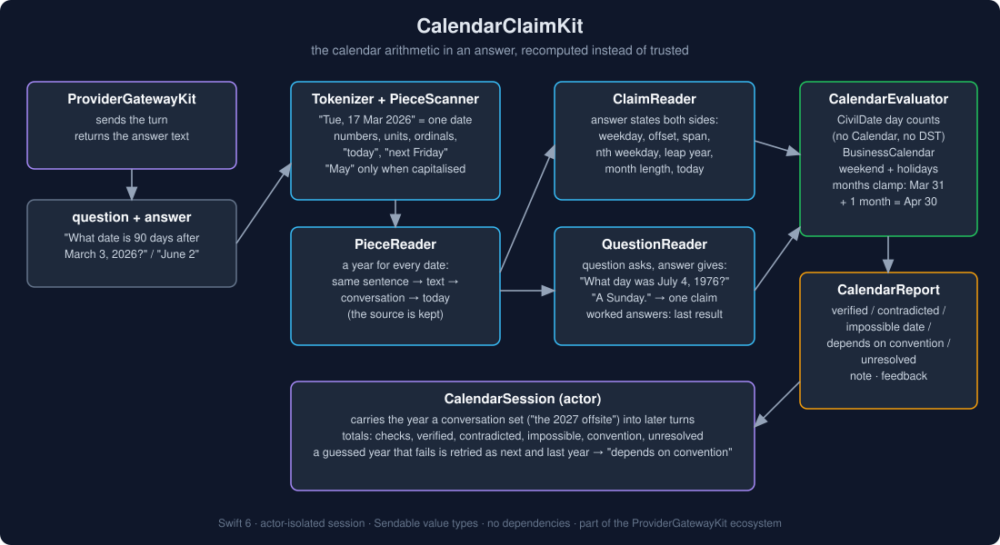
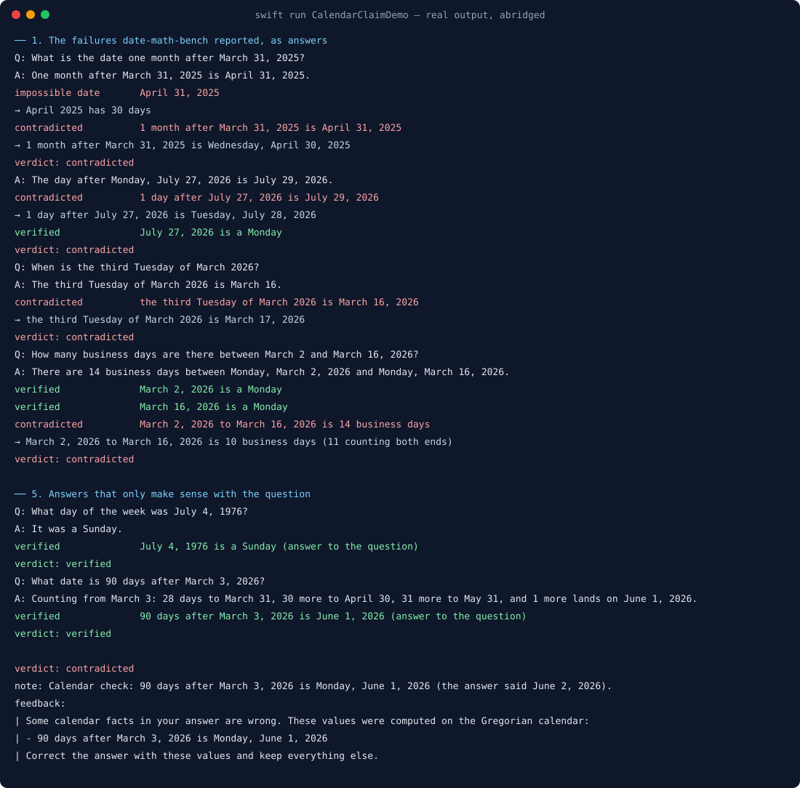
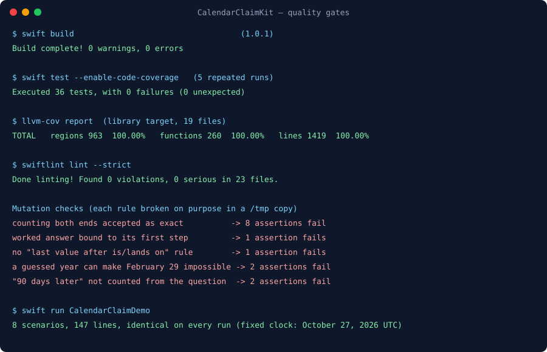

# CalendarClaimKit



A user asks when a 90-day trial that started on March 3, 2026 ends. The model answers "June 2, 2026,
a Tuesday". June 2 is a Tuesday, the sentence reads well, and the date is wrong: 90 days after March 3
is June 1. Nothing on screen says so. The same happens with "one month after March 31 is April 31",
with "the third Tuesday of March 2026 is March 16", and with "there are 14 business days" between two
Mondays two weeks apart.

CalendarClaimKit finds the calendar arithmetic in an answer and does it again: the weekday of a date,
a date some days, weeks, months or business days from another, the days between two dates, the nth
weekday of a month, leap years, month lengths, "today", "next Friday", and dates that do not exist. It
says which claims hold, which are wrong (with the right value), and which are true only under one
reading, such as counting both ends of a span. It also reads the question, so "What day of the week was
July 4, 1976?" answered "A Sunday." is checked even though the answer never repeats the date.

Part of the Swift LLM ecosystem around
[`ProviderGatewayKit`](https://github.com/rajatslakhina/foundation-model-provider-gateway).

## Why

Date arithmetic is a known weak spot, and the errors are confident. Maverick Y's
[date-math-bench](https://github.com/antrixy/date-math-bench) (described in
[*LLMs can't reliably do date math*](https://dev.to/maverickyadav/-llms-cant-reliably-do-date-math-and-now-theres-data-4hm2),
July 2026) sent 101 randomized date questions across 11 categories to five models. Pass rates ran
from 85% to 100%; on business days three of the five scored 2 or 3 out of 10, counting calendar days
instead. The failures it lists are the ones in the first paragraph: "April 31, 2025" for one month after
March 31, July 29 for the day after Monday July 27, March 16 for the third Tuesday of March 2026, and
ordinal day counts off by exactly one. Its advice is to compute dates in code rather than in prose, and
to look harder at simple date arithmetic, not less.

A chat client cannot make the model compute in code, but it can check what came back. The calendar is
the evidence: no retrieval, no tool output, no second model call.

Nothing else in this ecosystem did that. `NumberBindingKit` binds the figures in an answer to the
figures a tool or a source returned; a date the model worked out has nothing to bind to.
`TemporalValidityKit` decides which retrieved passages are still current. `ClaimConsistencyKit`
compares claim sentences with passage sentences.

## What it gives you

| Claim | Read from | Checked as |
|---|---|---|
| weekday of a date | "Tuesday, March 17, 2026", "March 17, 2026 is a Monday", "June 2, 2026, a Tuesday", "July 4, 1976 was not a Monday" | the weekday of that day |
| offset | "90 days after March 3", "3 weeks from today", "5 business days before June 1", "3 days ago", "in 10 days", "March 3 + 90 days", "the day after Monday, July 27", "ends 90 days later on June 2" | the date (or weekday, or "the 17th") it comes to |
| span | "there are 44 days between January 1 and February 14", "from March 3 to June 1 is 90 days", "300 days since January 1", "59 days until December 25" | days (exclusive), business days, weeks, months, years; "about", "over", "under", "more than", "fewer than" |
| nth weekday | "the third Tuesday of March 2026 is March 17", "the last Friday in October falls on the 30th", "March 17 is the third Tuesday of the month" | the day it falls on, or "March 2026 has no fifth Sunday" |
| leap year, lengths | "2100 is not a leap year", "2027 has 365 days", "February 2028 has 29 days", "April has 30 days" | the Gregorian rules |
| relative | "today is Tuesday, October 27", "tomorrow is the 28th", "next Friday is October 30", "last Friday was October 23" | the clock you pass in, in your time zone |
| impossible date | "April 31, 2025", "February 29, 2027", "February 30", "2026-02-30" | whether the day exists |

- **`CalendarChecker`** reads an answer (and optionally the question it answers), checks every claim
  and returns a `CalendarReport`.
- **`CalendarReport`** gives a verdict (`noClaims`, `verified`, `conventionDependent`, `contradicted`,
  `unverifiable`), one `CalendarCheck` per claim with what the text says and what the calendar says,
  `corrections` and `caveats` lines, a `note` for the person and a `feedback` prompt for the model with
  the computed values.
- **`CalendarSession`** (actor) carries the year a conversation set into later turns ("plan the 2027
  offsite", then "is March 17 free?"), and keeps totals.
- **`CivilDate`** and **`BusinessCalendar`** are the arithmetic, public so you can use them directly:
  day counts on the proleptic Gregorian calendar (no `Calendar`, no time zones, no daylight saving),
  month addition that clamps to the month's end, business days with your own weekend and holidays.

## Usage

```swift
import CalendarClaimKit

let session = CalendarSession(checker: CalendarChecker(timeZone: .current))
let answer = try await gateway.send(userMessage)          // ProviderGatewayKit, or any model call
let report = await session.review(answer: answer, question: userMessage, now: Date())
switch report.verdict {
case .contradicted:
    show(answer, note: report.note)                       // "90 days after March 3, 2026 is Monday,
                                                          //  June 1, 2026 (the answer said June 2, 2026)."
    let fixed = try await gateway.send(report.feedback ?? "")   // or hand it to OutputRepairKit
case .conventionDependent:
    show(answer, note: report.note)                       // "... is 91 days: true only counting both ends."
case .verified, .unverifiable, .noClaims:
    show(answer)
}
```

Without a session: `CalendarChecker().check(answer:question:now:contextYear:)`.

### Rules that decide a result

- **Spans count days exclusively**: March 3 to June 1 is 90 days. An answer that says 91 is not wrong,
  it counts both ends, so it is reported as *depends on convention* unless the sentence says "inclusive",
  "counting both" or "through", in which case 91 is the answer and 90 is wrong. Business days are counted
  after the start day up to and including the end day.
- **Weeks, months and years count whole units.** 44 days is "6 weeks and 2 days": "6 weeks" depends on
  convention, "about 6 weeks" and "over 6 weeks" hold, "exactly 7 weeks" is wrong.
- **One month after March 31 is April 30.** Month addition clamps to the end of a shorter month, as
  `Calendar`, `java.time` and Python's `dateutil` do.
- **"Next Friday" is the first Friday after today.** The Friday a week later is the other common reading,
  reported as *depends on convention*; "this Friday" may be today; "last Friday" is the most recent one
  before today.
- **A year comes from the nearest place that states one**: earlier in the same sentence, later in it
  ("between December 20 and January 5, 2027" gives December 20 the year before), earlier in the text,
  the question, an earlier turn, and only then today's year. A claim that fails with today's year and
  holds for next or last year is *depends on convention*: "March 17 is a Wednesday" is true for 2027.
  Without a clock, a date with no year is *unresolved*, not guessed.
- **A guessed year never makes a date impossible.** "February 29" with no year exists in some years.
- **A question's answer is bound carefully.** One value, however often repeated, is the answer. Otherwise
  the last value after "is", "it's", "lands on" or "=" is the result of a worked answer. Otherwise a first
  sentence with exactly one value is a direct answer. Otherwise nothing is checked, rather than checking
  an intermediate step. Dates the question gave are never taken as the answer.

## Where it sits

- **ProviderGatewayKit** sends the turn; this package checks the answer that comes back.
- **OutputRepairKit** runs a bounded repair loop; `report.feedback` carries the computed values.
- **NumberBindingKit** binds figures to tool and source output. This package needs no evidence: the
  calendar is the evidence. Run both.
- **ai-chat-app** runs it as the `calendarCheck` stage after the model answers.

## Demo

`swift run CalendarClaimDemo` runs eight scenarios against a fixed clock (Tuesday, October 27, 2026,
UTC). Real output, abridged (the whole run is in [`Screenshots/demo-output.txt`](Screenshots/demo-output.txt)):

```
── 1. The failures date-math-bench reported, as answers
   Q: What is the date one month after March 31, 2025?
   A: One month after March 31, 2025 is April 31, 2025.
   impossible date       April 31, 2025
                         → April 2025 has 30 days
   contradicted          1 month after March 31, 2025 is April 31, 2025
                         → 1 month after March 31, 2025 is Wednesday, April 30, 2025

── 3. Spans, and the off-by-one that depends on counting both ends
   A: From March 3 to June 1, 2026 is 91 days.
   depends on convention March 3, 2026 to June 1, 2026 is 91 days
                         → March 3, 2026 to June 1, 2026 is 90 days (91 counting both ends)
                           true only counting both ends

── 6. A year nobody stated
   Q: What day of the week is March 17?
   A: March 17 is a Wednesday.
   depends on convention March 17, 2026 is a Wednesday
                         → March 17, 2026 is a Tuesday
                           true for 2027; the year was not stated and 2026 was assumed
```



## Install

```swift
.package(url: "https://github.com/rajatslakhina/calendar-claim-kit.git", from: "1.0.0")
```

Swift tools 6.0, Swift 6 language mode. macOS 13, iOS 16, tvOS 16, watchOS 9. No dependencies.

## Quality gates

All run on this machine (Swift 6.4, SwiftLint 0.63.2), and again on a fresh clone of this repository
after it was pushed:

- `swift build`: 0 warnings, 0 errors.
- `swift test --enable-code-coverage`: 35 tests, 0 failures, green on 5 repeated runs.
- `llvm-cov report`: **100.00%** regions (959), functions (259) and lines (1415) on all 19 library files
  ([`Screenshots/coverage.txt`](Screenshots/coverage.txt)).
- `swiftlint lint --strict`: 0 violations in 23 files, no suppressions.
- Four rules were mutation-checked in a copy: accepting a both-ends count as exact fails 8 assertions;
  binding a worked answer to its first step fails 1; dropping the "last value after *is*" rule fails 1;
  letting a guessed year make February 29 impossible fails 2.

The demo was the first real use, and it found two gaps, each fixed and pinned by a test: a one-sentence
worked answer ("28 days to March 31, ... and 1 more lands on June 1") was bound to its first
intermediate date, and "it ends 90 days later on June 2, a Tuesday" was not read at all. A test then
found a third: "90 days later" in a sentence of its own could not see the date in the sentence before.



## Limits, stated plainly

- **English, Gregorian, lexical.** Dates written as words in other languages, other calendars, and
  phrasings outside the table above are not read. "Easter", "Thanksgiving" and other named days are not
  known, and neither are public holidays: pass them to `BusinessCalendar` yourself.
- **Numeric slash dates are not read.** "03/04/2026" is March 4 in one country and April 3 in another;
  the kit reads ISO dates (`2026-03-04`) and dates with month names only.
- **Times of day are ignored.** "In 36 hours" and "at 23:00 UTC, which is tomorrow in Tokyo" are not
  checked. "Today" is the date in the time zone you give the checker.
- **Ages and durations in prose** ("she turns 36 in March") are not read.
- **Binding an answer to a question is a heuristic.** A worked answer whose last "is" value is a side
  remark is checked on that remark; an answer with several candidate dates and no "is" is not checked.
- **The tests are home-made.** 35 tests written alongside the code show the rules do what they say, not
  how often real answers fall outside them.

## License

MIT. See [LICENSE](LICENSE).
